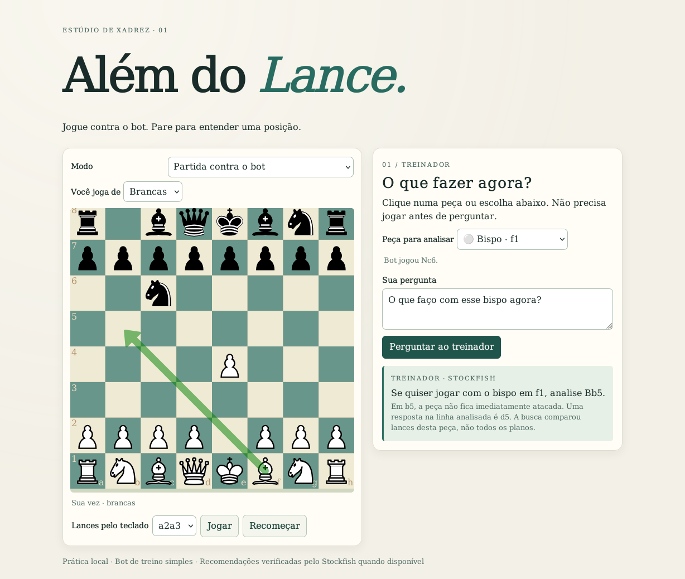

# Beyond the Move · Além do Lance

A Brazilian Portuguese chess practice studio. Choose White or Black, play a
casual game against a simple bot, and ask the coach about a piece in the
current position. This is for local study, not live-game assistance.



[Mobile view](docs/coach-mobile.png) · [Coach design](docs/piece-coach.md) ·
[Original LoRA model card](model/README.md)

## Try the coach

1. Choose **Brancas** or **Pretas**. The bot moves first if you play Black.
2. Click a piece or choose it in the list. Ask **“O que faço com esse bispo
   agora?”**, **“Está ameaçado?”** or **“Onde posso mover essa peça?”**.
   You can ask before playing.
3. A green arrow marks a searched legal suggestion. A red arrow in an exercise
   marks a possible opponent capture, not your move.

For a quick exercise, choose **Trocar ou ganhar material?**, play `c8f5` (`Bf5`)
and ask about the bishop. The coach says it's White's turn and that White
can capture the black queen with `Qxe5`. Reveal the line and step through the
reply; the coach follows the visible replay position.

## Run locally

Linux x86-64, Python 3.12 and [uv](https://docs.astral.sh/uv/). No Node build,
account or API key is needed.

```sh
uv sync --locked
uv run --locked python -m scripts.fetch_assets --engine-only
uv run --locked uvicorn beyond_move.app:app --host 127.0.0.1 --port 8765
```

Open <http://127.0.0.1:8765/>. The bot and board facts also work without
Stockfish. The optional 80 MB engine adds searched advice and exercise replay.
On CPUs without AVX2, point `STOCKFISH_PATH` to a compatible local UCI binary.

## How it works

FastAPI replays legal moves from the starting position or a known exercise.
The bot is deliberately weak: it favors material and avoids some attacked
squares, with deterministic tie-breaking. The coach routes PT-BR questions to
legal destinations, attack counts, or a Stockfish search constrained to the
selected piece. An arrow never comes from generated language. These are short
searches, not exhaustive strategy or claims about the best move overall.

The [v1.0.0 fine-tuning experiment](docs/training.md) remains reproducible.
Its [public LoRA](https://huggingface.co/pedrojb04/beyond-the-move) generated
short rationale-based hints, not current-position advice. A new 12-question
routing audit favored simple rules (11/12) over the same unchanged Qwen base
with a short prompt (6/12). The default coach uses rules and Stockfish; no new
adapter was trained or published.

## API and checks

- `POST /api/game`: reconstruct a standard position from `history` (UCI moves).
- `POST /api/bot`: `history` and player `side`; returns one legal opponent move.
- `POST /api/advice`: `history`, `side`, occupied `square`, `question`, and optional
  exercise `case_id`; returns text, exact FEN and optional move or threat.
- `/api/cases`, `/api/preview`, `/api/reveal` support prepared exercises.
  `/api/hint` preserves the original v1 experiment.

See `/docs` for schemas, [notices](NOTICE.md) for licenses, and
`uv run --locked python -m pytest -q` for backend tests.
