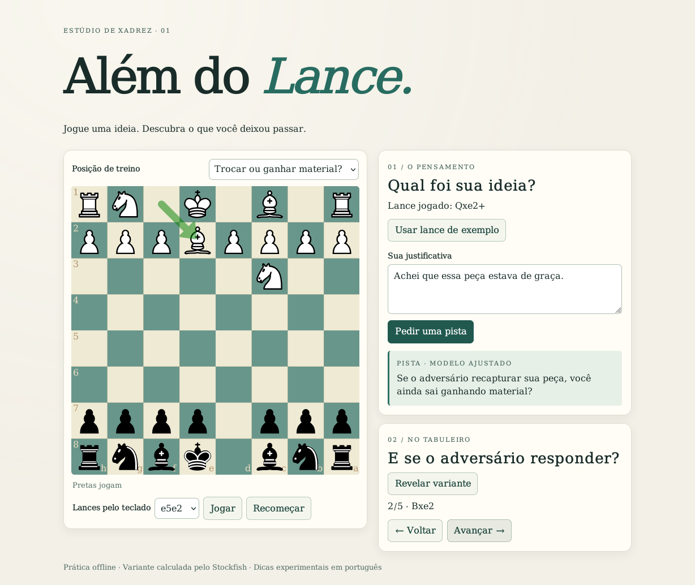

# Beyond the Move · Além do Lance

A small chess practice studio in Brazilian Portuguese. Play a move, explain what
you were trying to do, and get a question about your reasoning before revealing
an engine continuation. This is a study aid for prepared positions, not a
live-game assistant or a replacement for a coach.



[Mobile view](docs/demo-mobile.png) · [Model card](model/README.md) · [Training and sources](docs/training.md)

## Try the same move twice

In **Trocar ou ganhar material?**, play the example move `Qxe2+`. Then ask for a
hint with each rationale:

| Your reasoning | Observed hint from the released adapter |
|---|---|
| “Quero trocar as damas para simplificar.” | “Se o adversário aceitar a troca, o que muda nas peças que continuam no tabuleiro?” |
| “Achei que essa peça estava de graça.” | “Se o adversário recapturar sua peça, você ainda sai ganhando material?” |

Select **Revelar variante**, then **Avançar** twice to see the reply `Bxe2`.
The model does not calculate, play or reveal that line. The two responses above
are a demonstration, not a representative evaluation.

## Run locally

Linux x86-64, AVX2, Python 3.12, [uv](https://docs.astral.sh/uv/). The lightweight
board and its images are served locally. No Node.js build or API key is needed.

```sh
uv sync --locked --extra model
uv run --locked --extra model python -m scripts.fetch_assets
COACH_ADAPTER_PATH=model uv run --locked --extra model uvicorn beyond_move.app:app
```

Open <http://127.0.0.1:8000/>. Initial downloads include approximately 1 GB of
base weights and 80 MB for Stockfish, verified against pinned checksums.
On another CPU, set `STOCKFISH_PATH` to a compatible local UCI binary.
To run without the model, omit the extra and `COACH_ADAPTER_PATH` and use
`uv run --locked python -m scripts.fetch_assets --engine-only`; hints are
labeled **Regras**.

## What is actually trained?

Qwen2.5-0.5B-Instruct was adapted on CPU with rank-8 LoRA. The model receives a
learner rationale and three factual flags (capture, check and whether a legal
recapture exists), not a solution line. It suggests a coaching focus and emits a
short Portuguese question. Invalid outputs fall back to labeled rules; the
notation guard is deliberately conservative and cannot detect all indirect spoilers.

FastAPI validates the chosen move with python-chess. Stockfish computes a short
continuation from that move only when requested. The browser steps through
server-verified FEN frames, highlights the move and never uses model-generated moves.

| Held-out, 60 synthetic rationales / 12 position groups | Focus accuracy | Macro F1 | All 5 correct in a group | Invalid format |
|---|---:|---:|---:|---:|
| Same base model and zero-shot prompt | 0/60 | 0.000 | 0/12 | 60/60 |
| Keyword rules | 12/60 | 0.067 | 0/12 | 0/60 |
| LoRA adapter | 31/60 | 0.483 | 0/12 | 0/60 |

The base model's zero score includes failure to follow the schema under this
prompt; it is not a comparison with every possible prompting strategy. The adapter
still mixed up attack and defense and frequently mapped capture to trade. Repeated
synthetic paraphrases and a small number of independent positions make these
figures a smoke benchmark, not a measure of learning outcomes. The app is
experimental and restricted to three practice situations.

## HTTP and tests

- `GET /api/cases`: FEN, side to move and legal UCI moves for prepared cases.
- `POST /api/preview`: `{"case_id":"queen-trade","move":"e5e2"}` returns one
  validated SAN/FEN frame.
- `POST /api/hint`: same fields plus `reason` (3–280 characters); returns
  `focus`, `hint` and `source`, without a variation.
- `POST /api/reveal`: move body only; returns a bounded Stockfish line.
  Unknown cases return 404, invalid moves 422, unavailable engine 503.

OpenAPI UI: `/docs`. Run `uv run --locked python -m pytest -q` and
`uv run --locked ruff check .`. See [notices](NOTICE.md) for component licenses.
